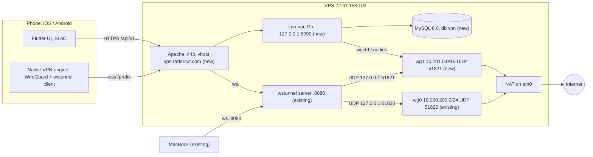
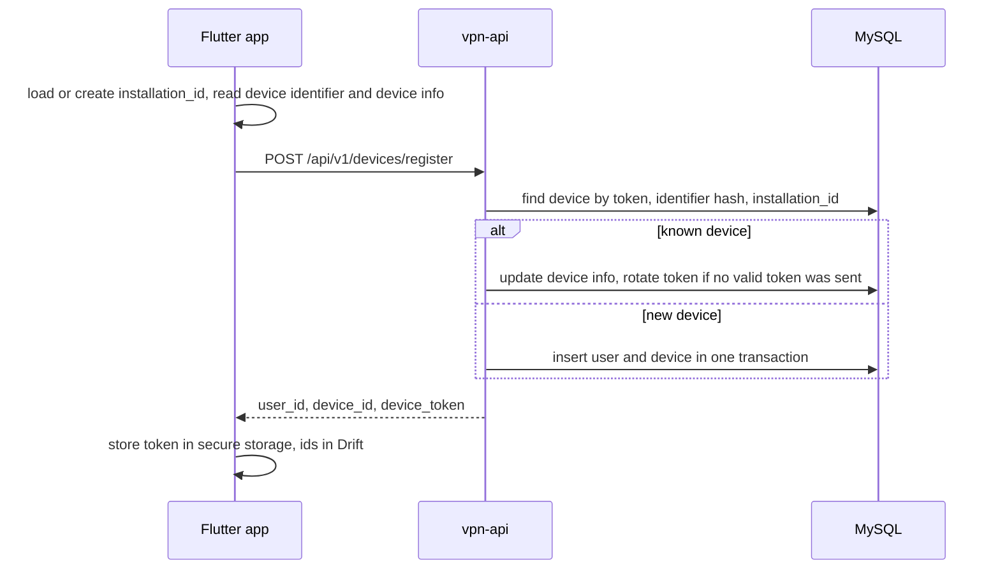
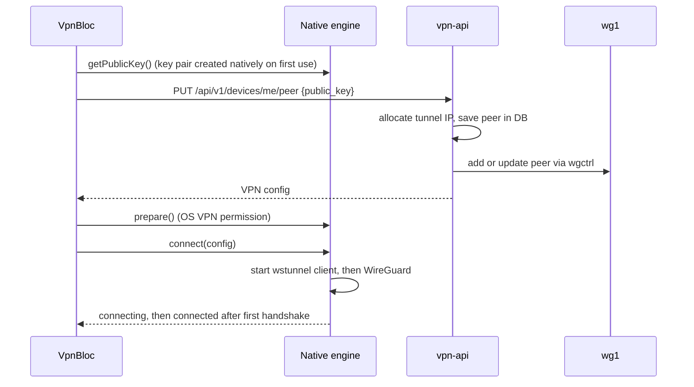

# System architecture

Status: **Proposed, awaiting approval.** Nothing described here is implemented or deployed yet.

Related documents: [Flutter](flutter_architecture.md) · [Backend](backend_architecture.md) · [Database](database.md) · [API](api.md) · [Existing VPS](vps_existing_infrastructure.md) · [Decisions](decisions/README.md)

## 1. Scope of v1

**In scope:** first launch, automatic device registration and user creation, VPN connect and disconnect, basic connection status, basic server information, and a minimal admin panel (login, users, devices, peer status, server status).

**Out of scope:** subscriptions, payments, lifetime or access codes, end-user accounts, multiple servers, marketing and analytics.

## 2. Overview



| Component | Location | New or existing |
| --- | --- | --- |
| Flutter app | iOS, Android | new |
| Native VPN engine (wireguard-go + embedded wstunnel client) | Android `VpnService`, iOS Packet Tunnel extension | new |
| Apache vhost `vpn.radarcut.com` (TLS, reverse proxy) | VPS :443 | Apache existing, vhost new |
| `vpn-api`: REST API, admin panel, peer provisioning | VPS `127.0.0.1:8090`, systemd | new |
| MySQL database `vpn` | VPS localhost (MySQL 8.0.46) | server existing, database new |
| wstunnel server 10.5.2 | VPS :8080 | existing, reused |
| WireGuard `wg1` for app clients | VPS, UDP 51821 reachable only from localhost | new |
| WireGuard `wg0` for the owner's MacBook | VPS, UDP 51820 | existing, untouched |

## 3. Mobile data path

```text
apps -> tun (wireguard-go) -> UDP 127.0.0.1:<local port>
  -> embedded wstunnel client -> wss://vpn.radarcut.com/<prefix> (TLS 443, Apache)
  -> ws://127.0.0.1:8080 (existing wstunnel server)
  -> UDP 127.0.0.1:51821 -> wg1 -> NAT on eth0 -> internet
```

The VPS public IP is excluded from the tunnel routes, so the wstunnel connection and API calls never loop back into the tunnel. IPv6 is routed into the tunnel and dropped there, which prevents IPv6 leaks, because the server has no IPv6 forwarding.

## 4. Main flows

### 4.1 First launch and registration



Registration runs silently on first launch. If it fails (for example offline), the home screen still opens and registration is retried on the first connect.

### 4.2 Connect



The last config is cached. If the API is unreachable, the app connects with the cached config and refreshes it later. If the handshake does not complete, the app re-provisions once.

### 4.3 Disconnect

The native engine stops WireGuard and then the wstunnel client. The peer stays provisioned on the server, so reconnecting needs no API call.

### 4.4 Admin

A browser opens `https://vpn.radarcut.com/admin`, which Apache proxies to `vpn-api` (server-rendered HTML). Users and devices come from the database; peer status comes live from `wg1` through `wgctrl`, with counters cached in the database.

## 5. Security model (summary)

- The mobile device identifier is a **recognition signal only**. Authentication uses a random per-device token issued by the backend and stored hashed ([ADR-0004](decisions/0004-device-recognition-and-authentication.md)).
- WireGuard private keys are generated on the device and never leave it ([ADR-0003](decisions/0003-client-generated-wireguard-keys.md)).
- `wg1` is isolated: no client-to-client traffic, no access to `wg0` or to VPS services, and outbound SMTP is blocked.
- Admin: argon2id passwords, secure session cookie, CSRF tokens, login rate limiting. Admins are created only through the CLI.
- Secrets live in `/etc/vpn-api/env` on the VPS, never in the repository, logs or docs.
- Data minimisation: no traffic, DNS or connection logs. The backend stores only each peer's last handshake and byte counters.

## 6. Repository layout

```text
ru_eu_vpn/
├── lib/ android/ ios/ test/   Flutter app (stays at the repo root)
├── backend/                   Go module: API, admin, deploy files
├── native/wstunnel_ffi/       Rust wrapper around the wstunnel client (after the spike)
└── docs/
```

## 7. Decisions

| ADR | Decision |
| --- | --- |
| [0001](decisions/0001-reuse-wstunnel-transport.md) | Reuse the existing wstunnel server as the mobile transport, exposed as `wss://` on 443 through Apache |
| [0002](decisions/0002-dedicated-wg1-interface.md) | A dedicated `wg1` interface for app clients; `wg0` stays untouched |
| [0003](decisions/0003-client-generated-wireguard-keys.md) | WireGuard keys are generated on the device |
| [0004](decisions/0004-device-recognition-and-authentication.md) | Device identifier for recognition, backend token for authentication |
| [0005](decisions/0005-backend-hosting-and-admin.md) | One Go binary behind the existing Apache, the existing MySQL, a server-rendered admin |
| [0006](decisions/0006-native-vpn-engine.md) | In-app native VPN engine: wireguard-go libraries plus an embedded wstunnel client |

## 8. Technical risks

| # | Risk | Impact | Mitigation |
| --- | --- | --- | --- |
| R1 | **No ready-made mobile wstunnel library.** It must be embedded through Rust FFI (or by running the Android binary). The iOS Packet Tunnel memory limit is about 50 MB. | High | Spike first on both platforms. Fallback: implement the wstunnel client protocol as a wireguard-go `Bind` ([ADR-0006](decisions/0006-native-vpn-engine.md)). |
| R2 | The existing wstunnel is an open relay into the VPS (finding F1). | Critical | Change C6, before any app traffic. |
| R3 | App store distribution: Apple requires VPN apps to be published by an organization account, and VPN apps have been removed from some regional storefronts (including Russia's). | High | Confirm account type and target storefronts before investing in iOS. |
| R4 | DPI and blocking: `ws://` is easy to detect; the Rust TLS fingerprint differs from browsers; blocking one domain or IP takes down both the API and the tunnel. | High | Use `wss` on 443 with a real certificate and a secret path. Later, separate domains or IPs and an alternative transport. |
| R5 | Shared VPS: VPN egress, abuse reports and blocklisting affect `radarcut.com`. The Hostinger terms for VPN/proxy use are unverified. | Medium | Block SMTP, isolate `wg1`, and plan a dedicated VPN VPS or IP. |
| R6 | WireGuard over WebSocket/TCP: TCP-over-TCP slowdowns on lossy mobile networks; MTU issues. | Medium | MTU 1280, WebSocket ping, measure. |
| R7 | DNS chicken-and-egg: the wstunnel client must reach `vpn.radarcut.com` while the tunnel's DNS is not up yet. | Medium | Resolve the server IP before the tunnel starts, connect by IP with SNI/Host set to the domain, and exclude that IP from routes. |
| R8 | `mobile_device_identifier` 0.1.0 is from an unverified publisher; MediaDrm-based IDs behave differently across Android vendors and can be missing. | Medium | Treat the identifier as optional; the installation ID is the fallback. |
| R9 | Anyone who knows a device identifier can re-register as that device and rotate its token. | Low in v1 (free, no personal data) | Before payments: App Attest / Play Integrity or account login. |
| R10 | Runtime `wg1` peers are lost when `wg1` restarts. | Low | The database is the source of truth; a reconciler re-applies peers on start and every 60 s. |
| R11 | Capacity: 2 vCPU; per-connection wstunnel CPU cost and the bandwidth quota are unknown. | Unknown | Load-test in Phase 3. |
| R12 | Android background limits and OEM battery killers stop the VPN. | Medium | Foreground service, always-on VPN guidance. |
| R13 | Apache WebSocket proxying of long-lived connections (timeouts). | Low | Proxy timeout settings plus 30 s WebSocket pings; test. |
| R14 | The VPN lives on a subdomain of the production site. A host name starting with `vpn.` is visible in TLS SNI and is an easy blocking target. A block of `vpn.radarcut.com` could escalate to all of `radarcut.com`, and the reverse is also true. | Medium | The tunnel URL is a backend config value delivered by the API (`transport.url`), so it can move to a neutral host name without an app release. Admin and API can stay on `vpn.radarcut.com`. |

## 9. Unknowns that need your input

1. ~~DNS record `vpn.radarcut.com`~~: done on 2026-11-16 (change C1).
2. Is it acceptable for the VPN to share the IP and the `radarcut.com` domain with the website in v1 (R5, R14)?
3. Target users and countries (the project name suggests Russia to the EU), which drives the anti-blocking needs and store availability.
4. Apple Developer account type (organization?) for team `RL5SKRM28G`, and Google Play account status.
5. VPS datacenter location (shown in the app as server info) and the monthly bandwidth quota.
6. Approval for the wstunnel hardening restart (C6).
7. Expected number of users in the first months.
8. Final app name and bundle IDs (currently `cz.scalesoft.ruEuVpn` on iOS and `cz.scalesoft.ru_eu_vpn` on Android).

## 10. Phase plan

- **Phase 2:** foundation, the security fix, the backend skeleton with registration, the Flutter skeleton with registration, and the native-engine spikes.
- **Phase 3:** peer provisioning, the `wg1` rollout, Android VPN end to end.
- **Phase 4:** iOS Packet Tunnel end to end.
- **Phase 5:** admin panel, hardening (C7), load test, store preparation.
