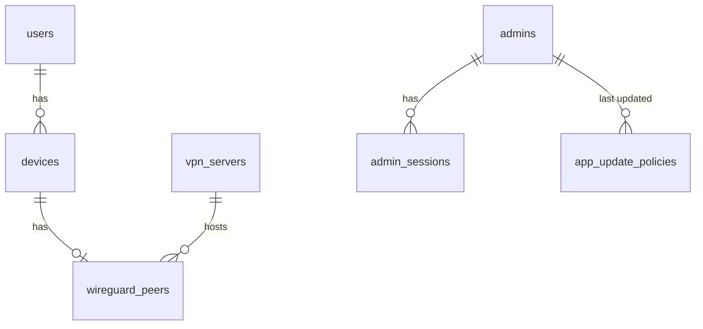

# Database (MySQL 8.0)

Status: **Proposed.** The database `vpn` lives on the existing MySQL 8.0.46 server on the VPS (bound to `127.0.0.1`, InnoDB, `utf8mb4`, strict SQL mode, system time zone UTC). The account is `'vpn_app'@'localhost'`, with privileges only on `vpn.*`.

PostgreSQL 16 is also installed on the VPS, but this project does not use it.

## 1. Conventions

| Concern | MySQL choice |
| --- | --- |
| Primary keys | UUIDv7 generated by the backend, stored as `CHAR(36) CHARACTER SET ascii` (readable in the CLI, scans directly into `uuid.UUID`) |
| Timestamps | `DATETIME(6)`, always UTC. The driver uses `parseTime=true`, `loc=UTC`, `time_zone='+00:00'`. |
| Hashes (token, identifier, session) | `BINARY(32)` |
| WireGuard keys | `CHAR(44) CHARACTER SET ascii COLLATE ascii_bin`. Base64 is case-sensitive, so the collation must be binary. |
| Tunnel IPv4 | `INT UNSIGNED` (`INET_ATON` / `INET_NTOA`), which makes IP allocation simple |
| Enumerations | `VARCHAR` + `CHECK` (enforced since MySQL 8.0.16) |
| Engine and charset | InnoDB, `utf8mb4`, `utf8mb4_0900_ai_ci` |

## 2. Entities



## 3. Schema (migration `0001_init.sql`)

```sql
CREATE TABLE users (
  id          CHAR(36) CHARACTER SET ascii NOT NULL,
  status      VARCHAR(16) NOT NULL DEFAULT 'active',
  created_at  DATETIME(6) NOT NULL DEFAULT CURRENT_TIMESTAMP(6),
  updated_at  DATETIME(6) NOT NULL DEFAULT CURRENT_TIMESTAMP(6) ON UPDATE CURRENT_TIMESTAMP(6),
  PRIMARY KEY (id),
  CONSTRAINT users_status_chk CHECK (status IN ('active', 'blocked'))
) ENGINE=InnoDB DEFAULT CHARSET=utf8mb4 COLLATE=utf8mb4_0900_ai_ci;

CREATE TABLE devices (
  id               CHAR(36) CHARACTER SET ascii NOT NULL,
  user_id          CHAR(36) CHARACTER SET ascii NOT NULL,
  platform         VARCHAR(16) NOT NULL,
  installation_id  CHAR(36) CHARACTER SET ascii NOT NULL,  -- random, generated by the app
  identifier_hash  BINARY(32) NULL,                         -- HMAC of mobile_device_identifier
  token_hash       BINARY(32) NOT NULL,                     -- SHA-256 of the current device token
  manufacturer     VARCHAR(100) NULL,
  model            VARCHAR(100) NULL,
  os_version       VARCHAR(50) NULL,
  app_version      VARCHAR(50) NULL,
  app_build        INT UNSIGNED NULL,                        -- last reported build, used by force upgrade
  status           VARCHAR(16) NOT NULL DEFAULT 'active',
  last_seen_at     DATETIME(6) NULL,
  created_at       DATETIME(6) NOT NULL DEFAULT CURRENT_TIMESTAMP(6),
  updated_at       DATETIME(6) NOT NULL DEFAULT CURRENT_TIMESTAMP(6) ON UPDATE CURRENT_TIMESTAMP(6),
  PRIMARY KEY (id),
  UNIQUE KEY devices_installation_uq (installation_id),
  UNIQUE KEY devices_platform_identifier_uq (platform, identifier_hash),  -- NULLs never collide
  UNIQUE KEY devices_token_uq (token_hash),
  KEY devices_user_idx (user_id),
  CONSTRAINT devices_user_fk FOREIGN KEY (user_id) REFERENCES users (id),
  CONSTRAINT devices_platform_chk CHECK (platform IN ('android', 'ios')),
  CONSTRAINT devices_status_chk CHECK (status IN ('active', 'blocked'))
) ENGINE=InnoDB DEFAULT CHARSET=utf8mb4 COLLATE=utf8mb4_0900_ai_ci;

CREATE TABLE vpn_servers (
  id             CHAR(36) CHARACTER SET ascii NOT NULL,
  name           VARCHAR(100) NOT NULL,
  country_code   CHAR(2) NULL,
  city           VARCHAR(100) NULL,
  public_host    VARCHAR(255) NOT NULL,                        -- vpn.radarcut.com
  public_ips     JSON NOT NULL,                                -- ["72.61.158.103"], excluded from client routes
  wg_interface   VARCHAR(15) NOT NULL,                         -- wg1
  wg_public_key  CHAR(44) CHARACTER SET ascii COLLATE ascii_bin NOT NULL,
  tunnel_cidr    VARCHAR(18) NOT NULL,                         -- 10.201.0.0/16
  is_active      BOOLEAN NOT NULL DEFAULT TRUE,
  created_at     DATETIME(6) NOT NULL DEFAULT CURRENT_TIMESTAMP(6),
  updated_at     DATETIME(6) NOT NULL DEFAULT CURRENT_TIMESTAMP(6) ON UPDATE CURRENT_TIMESTAMP(6),
  PRIMARY KEY (id)
) ENGINE=InnoDB DEFAULT CHARSET=utf8mb4 COLLATE=utf8mb4_0900_ai_ci;

CREATE TABLE wireguard_peers (
  id                 CHAR(36) CHARACTER SET ascii NOT NULL,
  device_id          CHAR(36) CHARACTER SET ascii NOT NULL,
  server_id          CHAR(36) CHARACTER SET ascii NOT NULL,
  public_key         CHAR(44) CHARACTER SET ascii COLLATE ascii_bin NOT NULL,
  tunnel_ipv4        INT UNSIGNED NOT NULL,
  last_handshake_at  DATETIME(6) NULL,
  rx_bytes           BIGINT UNSIGNED NOT NULL DEFAULT 0,
  tx_bytes           BIGINT UNSIGNED NOT NULL DEFAULT 0,
  stats_updated_at   DATETIME(6) NULL,
  created_at         DATETIME(6) NOT NULL DEFAULT CURRENT_TIMESTAMP(6),
  updated_at         DATETIME(6) NOT NULL DEFAULT CURRENT_TIMESTAMP(6) ON UPDATE CURRENT_TIMESTAMP(6),
  PRIMARY KEY (id),
  UNIQUE KEY wireguard_peers_device_server_uq (device_id, server_id),
  UNIQUE KEY wireguard_peers_ip_uq (server_id, tunnel_ipv4),
  UNIQUE KEY wireguard_peers_key_uq (public_key),
  CONSTRAINT wireguard_peers_device_fk FOREIGN KEY (device_id) REFERENCES devices (id) ON DELETE CASCADE,
  CONSTRAINT wireguard_peers_server_fk FOREIGN KEY (server_id) REFERENCES vpn_servers (id)
) ENGINE=InnoDB DEFAULT CHARSET=utf8mb4 COLLATE=utf8mb4_0900_ai_ci;

CREATE TABLE admins (
  id             CHAR(36) CHARACTER SET ascii NOT NULL,
  username       VARCHAR(64) NOT NULL,
  password_hash  VARCHAR(255) NOT NULL,                        -- argon2id encoded string
  disabled_at    DATETIME(6) NULL,
  last_login_at  DATETIME(6) NULL,
  created_at     DATETIME(6) NOT NULL DEFAULT CURRENT_TIMESTAMP(6),
  PRIMARY KEY (id),
  UNIQUE KEY admins_username_uq (username)
) ENGINE=InnoDB DEFAULT CHARSET=utf8mb4 COLLATE=utf8mb4_0900_ai_ci;

CREATE TABLE admin_sessions (
  token_hash    BINARY(32) NOT NULL,                           -- SHA-256 of the session cookie value
  admin_id      CHAR(36) CHARACTER SET ascii NOT NULL,
  csrf_token    CHAR(43) CHARACTER SET ascii COLLATE ascii_bin NOT NULL,
  ip            VARCHAR(45) NULL,
  user_agent    VARCHAR(255) NULL,
  created_at    DATETIME(6) NOT NULL DEFAULT CURRENT_TIMESTAMP(6),
  last_seen_at  DATETIME(6) NOT NULL DEFAULT CURRENT_TIMESTAMP(6),
  expires_at    DATETIME(6) NOT NULL,
  PRIMARY KEY (token_hash),
  KEY admin_sessions_admin_idx (admin_id),
  CONSTRAINT admin_sessions_admin_fk FOREIGN KEY (admin_id) REFERENCES admins (id) ON DELETE CASCADE
) ENGINE=InnoDB DEFAULT CHARSET=utf8mb4 COLLATE=utf8mb4_0900_ai_ci;

CREATE TABLE app_update_policies (
  platform             VARCHAR(16) NOT NULL,
  min_supported_build  INT UNSIGNED NOT NULL DEFAULT 0,       -- below this build: force upgrade
  latest_build         INT UNSIGNED NOT NULL DEFAULT 0,       -- below this build: soft prompt
  update_url           VARCHAR(500) NULL,
  message              VARCHAR(500) NULL,
  updated_by           CHAR(36) CHARACTER SET ascii NULL,
  updated_at           DATETIME(6) NOT NULL DEFAULT CURRENT_TIMESTAMP(6) ON UPDATE CURRENT_TIMESTAMP(6),
  PRIMARY KEY (platform),
  CONSTRAINT app_update_policies_platform_chk CHECK (platform IN ('android', 'ios')),
  CONSTRAINT app_update_policies_builds_chk CHECK (latest_build >= min_supported_build),
  CONSTRAINT app_update_policies_admin_fk FOREIGN KEY (updated_by) REFERENCES admins (id) ON DELETE SET NULL
) ENGINE=InnoDB DEFAULT CHARSET=utf8mb4 COLLATE=utf8mb4_0900_ai_ci;

INSERT INTO app_update_policies (platform) VALUES ('android'), ('ios');  -- 0 = nothing forced
```

## 4. Rules and notes

- **No duplicates:** every recognition signal has a unique index. Registration runs in a `READ COMMITTED` transaction: look up the device, otherwise insert the user and the device. A duplicate-key error (1062) from a concurrent request, or a deadlock (1213), triggers one retry of the lookup. Repeated requests therefore converge on the same user and device.
- **Signal priority:** valid token, then `(platform, identifier_hash)`, then `installation_id`. When a device is matched, its missing signals are filled in. If two different devices would match, the token or identifier match wins and the conflict is logged without merging.
- **One user per device in v1.** Linking several devices to one user comes later, with accounts.
- **One peer row per device and server.** MySQL has no partial indexes, so `wireguard_peers` holds only the current peer. Revoking a peer deletes the row, which frees its IP. No peer history is kept in v1.
- **IP allocation:** the first free `tunnel_ipv4` in the server's CIDR, skipping the network address, `.1` and the broadcast address. `wireguard_peers_ip_uq` guards against races, and a duplicate-key error retries the allocation.
- **The server row** is seeded and updated from config at startup (single server in v1: Germany, `DE`).
- **Force upgrade:** one `app_update_policies` row per platform, edited only in the admin panel. `devices.app_build` is updated from the `X-App-Build` header, so the panel can show how many devices a new minimum would block ([ADR-0007](decisions/0007-force-upgrade.md)).
- **Migrations:** MySQL DDL is not transactional, so a failed migration can leave partial changes. Migrations stay small and are tested on the local Docker MySQL first.
- **Not stored:** traffic, DNS or connection logs, raw device identifiers, WireGuard private keys, plaintext tokens or passwords.
- **Server status** (load, uptime, interface state) is read live and not stored.
- **Backups (Phase 5):** a daily `mysqldump --single-transaction vpn` to a root-only directory.
