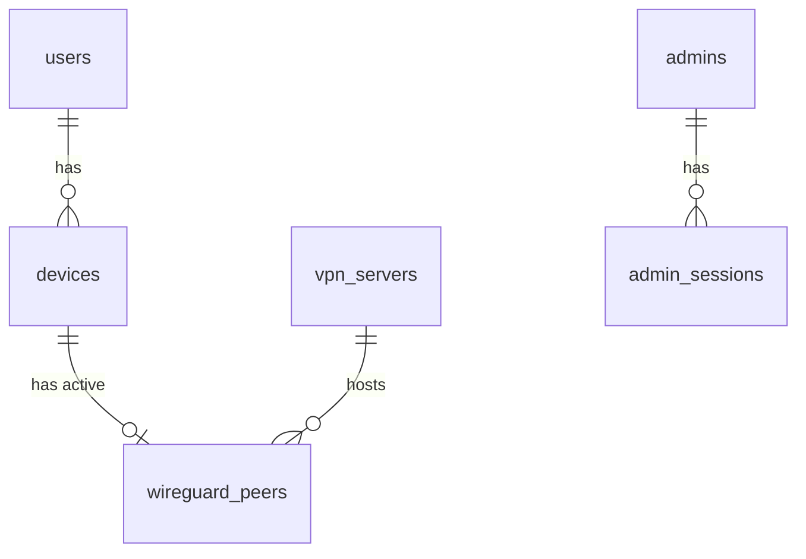

# Database (PostgreSQL 16)

Status: **Proposed.** The database `vpn` is owned by role `vpn_app` and lives on the existing PostgreSQL 16 server (localhost only). All primary keys are UUIDv7 generated by the backend.

## 1. Entities



## 2. Schema (migration `0001_init.sql`)

```sql
CREATE TABLE users (
  id          uuid PRIMARY KEY,
  status      text NOT NULL DEFAULT 'active' CHECK (status IN ('active', 'blocked')),
  created_at  timestamptz NOT NULL DEFAULT now(),
  updated_at  timestamptz NOT NULL DEFAULT now()
);

CREATE TABLE devices (
  id               uuid PRIMARY KEY,
  user_id          uuid NOT NULL REFERENCES users (id),
  platform         text NOT NULL CHECK (platform IN ('android', 'ios')),
  installation_id  uuid NOT NULL UNIQUE,          -- random, generated by the app
  identifier_hash  bytea,                         -- HMAC of mobile_device_identifier, NULL if unavailable
  token_hash       bytea NOT NULL UNIQUE,         -- SHA-256 of the current device token
  manufacturer     text,
  model            text,
  os_version       text,
  app_version      text,
  status           text NOT NULL DEFAULT 'active' CHECK (status IN ('active', 'blocked')),
  last_seen_at     timestamptz,
  created_at       timestamptz NOT NULL DEFAULT now(),
  updated_at       timestamptz NOT NULL DEFAULT now()
);
CREATE UNIQUE INDEX devices_platform_identifier_uq
  ON devices (platform, identifier_hash) WHERE identifier_hash IS NOT NULL;
CREATE INDEX devices_user_id_idx ON devices (user_id);

CREATE TABLE vpn_servers (
  id             uuid PRIMARY KEY,
  name           text NOT NULL,
  country_code   char(2),
  city           text,
  public_host    text NOT NULL,                   -- vpn.petrixon.com
  public_ips     inet[] NOT NULL,                 -- excluded from client routes
  wg_interface   text NOT NULL,                   -- wg1
  wg_public_key  text NOT NULL,
  tunnel_cidr    cidr NOT NULL,                   -- 10.201.0.0/16
  is_active      boolean NOT NULL DEFAULT true,
  created_at     timestamptz NOT NULL DEFAULT now(),
  updated_at     timestamptz NOT NULL DEFAULT now()
);

CREATE TABLE wireguard_peers (
  id                 uuid PRIMARY KEY,
  device_id          uuid NOT NULL REFERENCES devices (id),
  server_id          uuid NOT NULL REFERENCES vpn_servers (id),
  public_key         text NOT NULL,
  tunnel_ipv4        inet NOT NULL,
  status             text NOT NULL DEFAULT 'active' CHECK (status IN ('active', 'revoked')),
  last_handshake_at  timestamptz,
  rx_bytes           bigint NOT NULL DEFAULT 0,
  tx_bytes           bigint NOT NULL DEFAULT 0,
  stats_updated_at   timestamptz,
  created_at         timestamptz NOT NULL DEFAULT now(),
  updated_at         timestamptz NOT NULL DEFAULT now(),
  revoked_at         timestamptz
);
CREATE UNIQUE INDEX wireguard_peers_device_active_uq
  ON wireguard_peers (device_id, server_id) WHERE status = 'active';
CREATE UNIQUE INDEX wireguard_peers_ip_active_uq
  ON wireguard_peers (server_id, tunnel_ipv4) WHERE status = 'active';
CREATE UNIQUE INDEX wireguard_peers_key_active_uq
  ON wireguard_peers (public_key) WHERE status = 'active';

CREATE TABLE admins (
  id             uuid PRIMARY KEY,
  username       text NOT NULL UNIQUE,
  password_hash  text NOT NULL,                   -- argon2id encoded string
  disabled_at    timestamptz,
  last_login_at  timestamptz,
  created_at     timestamptz NOT NULL DEFAULT now()
);

CREATE TABLE admin_sessions (
  token_hash    bytea PRIMARY KEY,                -- SHA-256 of the session cookie value
  admin_id      uuid NOT NULL REFERENCES admins (id) ON DELETE CASCADE,
  csrf_token    text NOT NULL,
  ip            inet,
  user_agent    text,
  created_at    timestamptz NOT NULL DEFAULT now(),
  last_seen_at  timestamptz NOT NULL DEFAULT now(),
  expires_at    timestamptz NOT NULL
);
```

## 3. Rules and notes

- **No duplicates:** every recognition signal has a unique index. The registration transaction uses `INSERT ... ON CONFLICT`, so repeated or concurrent requests converge on the same user and device.
- **Signal priority:** valid token, then `(platform, identifier_hash)`, then `installation_id`. When a device is matched, its missing signals are filled in. If two different devices would match, the token or identifier match wins and the conflict is logged without merging.
- **One user per device in v1.** Linking several devices to one user comes later, with accounts.
- **The server row** is seeded and updated from config at startup (single server in v1).
- **WireGuard state:** active rows in `wireguard_peers` are the desired state of `wg1`. Revoked rows are kept for history, and their IP becomes reusable.
- **Not stored:** traffic, DNS or connection logs, raw device identifiers, WireGuard private keys, plaintext tokens or passwords.
- **Server status** (load, uptime, interface state) is read live and not stored.
